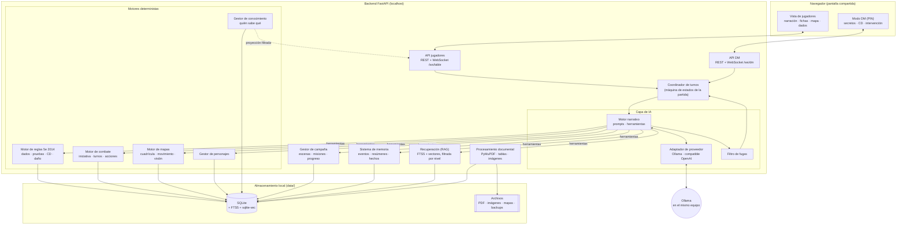

# 2. Arquitectura técnica

> Cubre los puntos 4 (arquitectura), 5 (justificación de tecnologías), 6 (diagrama), 7 (organización de módulos), 19 (estructura de archivos) y 20 (dependencias).

## 2.1 Principio rector

**La IA propone, el motor dispone.**

- El LLM interpreta, decide dentro de sus atribuciones y narra.
- El LLM **no escribe en la base de datos**. Solo puede llamar a *herramientas* (funciones del backend) con argumentos tipados. Cada herramienta valida, aplica las reglas y devuelve el resultado.
- Las tiradas las genera el servidor (o las introduce un jugador). El LLM recibe el resultado ya calculado y lo narra.
- El estado real del mundo y lo que saben los jugadores son datos distintos. El backend construye siempre una **proyección** filtrada antes de enviar nada a la interfaz de jugadores o al contexto del LLM.

## 2.2 Arquitectura propuesta

Monolito modular en el backend (un solo proceso FastAPI) con módulos de dominio bien separados, y una SPA en React. Para una aplicación local con un solo grupo, un monolito modular es más simple de instalar, depurar y respaldar que microservicios, y la separación por módulos con interfaces explícitas permite extraer piezas más adelante si hiciera falta (por ejemplo, el procesamiento de PDF a un proceso aparte).



### Flujo de una petición (resumen)

1. La interfaz envía `{jugador_activo, personaje, texto}` por `/ws/table`.
2. El **coordinador** comprueba que la partida está en un estado que admite acciones (no hay una tirada pendiente, es el turno correcto en combate).
3. El **motor narrativo** construye el contexto: proyección de la escena, ficha del personaje, hechos relevantes de memoria y fragmentos recuperados por RAG.
4. El LLM responde con llamadas a herramientas (`solicitar_prueba`, `mover_token`, `revelar_hecho`, `hablar_como_npc`…) y/o texto narrativo.
5. Cada herramienta pasa por el motor correspondiente, que valida y emite **eventos**.
6. Si hay una tirada pendiente, la partida pasa a `ESPERANDO_TIRADA` y se detiene.
7. La narración pasa por el **filtro de fugas** y se envía por streaming a la pantalla.
8. El gestor de conocimiento recalcula la proyección y la API envía solo el diff permitido.

## 2.3 Tecnologías y justificación

Se mantienen las tecnologías propuestas en el prompt maestro salvo donde se indica. Los cambios son **añadidos**, no sustituciones.

| Componente | Elección | Justificación |
|---|---|---|
| Frontend | React 18 + TypeScript (`strict`) + Vite | Propuesta original. Vite da arranque y recarga rápidos sin configuración compleja |
| Estilos | Tailwind CSS | Propuesta original. Se define un tema propio (pergamino, tinta, oro, sangre) en `tailwind.config` para que la estética sea coherente |
| Estado en cliente | Zustand + TanStack Query | **Añadido.** Zustand para el estado de la mesa (pequeño y explícito); TanStack Query para cachear lecturas REST e invalidarlas al recibir eventos por WebSocket |
| Mapas | Konva.js con `react-konva` | Propuesta original. Capas separadas (fondo, cuadrícula, tokens, niebla, UI) y eventos por figura, suficiente para mapas de hasta ~100×100 casillas |
| Backend | Python 3.12 + FastAPI + Uvicorn | Propuesta original. Python tiene el mejor ecosistema para PDF, OCR y RAG; FastAPI da tipado con Pydantic y WebSocket nativo |
| Validación | Pydantic v2 | Esquemas compartidos para API, herramientas del LLM y salidas estructuradas |
| Base de datos | SQLite (modo WAL) | Propuesta original. Un archivo, sin servidor, fácil de respaldar |
| ORM y migraciones | SQLAlchemy 2.0 + **Alembic** | Alembic **añadido**: sin migraciones versionadas, cada cambio de modelo rompería las partidas guardadas |
| Búsqueda | SQLite FTS5 + **sqlite-vec** | **Añadido.** FTS5 para búsqueda por palabras (nombres propios, "sala 12") y sqlite-vec para similitud semántica, todo dentro del mismo archivo SQLite |
| Embeddings | `qwen3-embedding` servido por Ollama (0.6b por defecto; 4b/8b si hay memoria) | **Decidido (D-11).** Multilingüe y local. Al usar Ollama no hace falta instalar PyTorch ni `sentence-transformers`, lo que simplifica mucho la instalación en Windows |
| PDF | PyMuPDF | Propuesta original. Texto con posición, imágenes, tablas (`find_tables`) y metadatos de página |
| OCR | Tesseract (vía PyMuPDF/`pytesseract`) con idioma `spa` | Opcional, solo para PDF escaneados |
| Comunicación | WebSocket (FastAPI) + REST | Propuesta original. REST para CRUD; WebSocket para narración en streaming y eventos de mesa |
| IA | **Ollama local (D-10)**, modelo por defecto `qwen3.8:27b`, a través de un adaptador propio | Ver 2.4 |
| RAG | **Implementación propia** (no LlamaIndex) | Ver 2.4 |
| Pruebas backend | Pytest + **Hypothesis** | Hypothesis **añadido** para pruebas basadas en propiedades del motor de reglas (p. ej. "la vida nunca supera el máximo") |
| Pruebas frontend | Vitest + Testing Library + **Playwright** | Playwright **añadido** para pruebas de extremo a extremo de la sesión |
| Calidad | Ruff, mypy, ESLint, Prettier, pre-commit, GitHub Actions | Lint y tipos en cada PR |

## 2.4 Decisiones que se apartan de la propuesta original

### RAG propio en lugar de LlamaIndex

El requisito más delicado del proyecto es que **la recuperación nunca devuelva información que el contexto actual no puede ver**. Ese filtro tiene que aplicarse dentro de la consulta SQL (`WHERE knowledge_level IN (...) AND ...`), no después. Con una implementación propia de ~300 líneas sobre FTS5 + sqlite-vec:

- El filtro de visibilidad es parte de la consulta y se prueba de forma unitaria.
- No hay otra capa de abstracción que actualice su API con frecuencia.
- Se mantiene la cita exacta (documento, página, sección) en cada fragmento.

LlamaIndex sigue siendo una opción si más adelante se necesitan sus lectores o estrategias avanzadas; la interfaz `Retriever` permite cambiarlo.

### Adaptador de proveedor propio en lugar de una librería genérica

Se define una interfaz mínima:

```text
LLMProvider.generate(messages, tools, response_schema, stream) -> respuesta
LLMProvider.embed(texts) -> vectores   (opcional)
```

con `OllamaProvider` como implementación principal y `OpenAICompatibleProvider` como segunda opción (sirve para LM Studio, llama.cpp `llama-server` y, si algún día se quiere, servicios en la nube). Así el resto del sistema no conoce el proveedor (RNF-03).

**Decisión D-10: Ollama local, sin claves de API.** Consecuencias para el diseño:

- El modelo elegido depende de la memoria de vídeo (VRAM) del equipo. El nombre del modelo es configuración (`VDM_LLM_MODEL`), no código.
- Los modelos locales son menos fiables que los de la nube al usar herramientas y al guardar secretos. Por eso cobran todavía más importancia las defensas estructurales (5.5): el modelo nunca recibe lo que no debe revelar fuera de la escena, y toda mecánica pasa por herramientas validadas.
- Se usarán **salidas estructuradas** de Ollama (parámetro `format` con esquema JSON) para la clasificación de acciones y los resúmenes, en lugar de confiar en que el texto libre tenga el formato correcto.
- El presupuesto de contexto (~12 000 tokens) importa doblemente: un contexto largo consume VRAM y hace más lenta la respuesta.
- Se puede separar el modelo de narración (grande) del de tareas auxiliares (clasificar, resumir) para ahorrar tiempo.

## 2.5 Organización de módulos

| Módulo (backend) | Responsabilidad | Depende de |
|---|---|---|
| `engines/rules` | Dados, características, habilidades, CD, ventaja, pruebas, daño, condiciones (5e 2014) | — |
| `engines/combat` | Iniciativa, turnos, economía de acción, ataques, oportunidad, concentración, muerte | `rules`, `maps` |
| `engines/maps` | Cuadrícula, coordenadas, distancias, movimiento, línea de visión, iluminación, niebla | — |
| `engines/narrative` | Ciclo del turno de IA, construcción de contexto, herramientas expuestas al LLM | `ai`, todos los motores (vía servicios) |
| `services/characters` | Fichas, inventario, recursos, historial de cambios | `rules` |
| `services/campaign` | Campañas, escenas, misiones, encuentros, progreso | — |
| `services/knowledge` | Niveles de información, descubrimientos, proyecciones por destinatario | `maps` |
| `memory` | Eventos, hechos, resúmenes, memoria de NPC | `ai` (para resumir) |
| `document_processing` | Ingesta de PDF, OCR, segmentación, clasificación, indexación | `ai` (clasificación), `memory` (índice) |
| `ai` | Proveedores LLM, plantillas de prompts, filtro de fugas | — |
| `api` | Rutas REST y WebSocket, autenticación del modo DM | `services`, `engines` |

Regla de dependencias: los motores (`engines/rules`, `engines/maps`) **no importan nada** de IA ni de base de datos; reciben datos y devuelven resultados. Así se prueban sin LLM y sin base de datos.

## 2.6 Estructura de archivos

Se respeta la estructura propuesta con tres cambios justificados: `backend/app/game_systems/` para aislar las reglas de 5e (RNF-15), `backend/tests/` y `frontend/tests/` junto a cada proyecto (cada uno con su herramienta de pruebas), y `data/` fuera del control de versiones.

```text
proyecto-dm/
├── README.md
├── docs/                      # análisis, diseño, decisiones, registro
├── .github/workflows/         # CI: lint + tipos + pruebas
├── backend/
│   ├── pyproject.toml
│   ├── alembic.ini
│   ├── alembic/versions/
│   ├── app/
│   │   ├── main.py            # crea la app FastAPI
│   │   ├── config.py          # ajustes (pydantic-settings, .env)
│   │   ├── db.py              # motor SQLAlchemy, sesión, WAL
│   │   ├── api/
│   │   │   ├── table/         # rutas de jugadores
│   │   │   ├── dm/            # rutas del modo DM
│   │   │   └── ws.py          # WebSocket /ws/table y /ws/dm
│   │   ├── models/            # modelos SQLAlchemy
│   │   ├── schemas/           # modelos Pydantic (API y herramientas)
│   │   ├── services/
│   │   │   ├── campaign/
│   │   │   ├── characters/
│   │   │   └── knowledge/
│   │   ├── engines/
│   │   │   ├── rules/
│   │   │   ├── combat/
│   │   │   ├── maps/
│   │   │   └── narrative/
│   │   ├── game_systems/
│   │   │   └── dnd5e_2014/    # datos SRD 5.1 y constantes de reglas
│   │   ├── ai/
│   │   │   ├── providers/
│   │   │   ├── prompts/
│   │   │   └── guard/
│   │   ├── memory/
│   │   └── document_processing/
│   └── tests/
│       ├── unit/
│       ├── integration/
│       ├── fixtures/          # aventura de prueba propia (sin material con copyright)
│       └── llm_evals/         # pruebas de comportamiento de la IA
├── frontend/
│   ├── package.json
│   ├── vite.config.ts
│   ├── tailwind.config.ts
│   ├── src/
│   │   ├── app/               # rutas, layout, proveedores
│   │   ├── components/        # componentes compartidos (botones, paneles, pergamino)
│   │   ├── pages/
│   │   ├── features/
│   │   │   ├── campaign/
│   │   │   ├── characters/
│   │   │   ├── narration/
│   │   │   ├── combat/
│   │   │   ├── maps/
│   │   │   ├── dice/
│   │   │   └── dm/
│   │   ├── services/          # cliente REST y WebSocket
│   │   ├── stores/            # Zustand (mesa y DM separados)
│   │   └── i18n/es.json
│   └── tests/
└── data/                      # NO versionado (.gitignore)
    ├── vdm.sqlite3
    ├── campaigns/<id>/documents/
    ├── campaigns/<id>/assets/
    ├── maps/
    ├── characters/
    └── backups/
```

## 2.7 Dependencias

Versiones mínimas orientativas; se fijarán en `pyproject.toml` y `package.json` al iniciar la fase 1.

### Backend (Python 3.12+)

| Paquete | Uso | Fase |
|---|---|---|
| `fastapi`, `uvicorn[standard]` | Servidor HTTP y WebSocket | 1 |
| `pydantic` v2, `pydantic-settings` | Esquemas y configuración | 1 |
| `sqlalchemy` 2.x, `alembic` | ORM y migraciones | 1 |
| `python-multipart` | Subida de PDF | 2 |
| `pymupdf` | Texto, imágenes, tablas de PDF | 2 |
| `pytesseract` + Tesseract instalado en el sistema | OCR (opcional) | 2 |
| `sqlite-vec` | Búsqueda vectorial en SQLite | 2–3 |
| `httpx` | Cliente HTTP para la API de Ollama y la compatible con OpenAI (sin SDK de terceros) | 2–3 |
| `pillow`, `numpy` | Tratamiento de imágenes de mapas | 6 |
| `pytest`, `pytest-asyncio`, `hypothesis`, `httpx` | Pruebas | 1 |
| `ruff`, `mypy` | Lint y tipos | 1 |

### Frontend (Node 20+)

| Paquete | Uso | Fase |
|---|---|---|
| `react`, `react-dom`, `react-router-dom` | Interfaz y rutas | 1 |
| `typescript`, `vite`, `@vitejs/plugin-react` | Compilación | 1 |
| `tailwindcss` | Estilos | 1 |
| `zustand`, `@tanstack/react-query` | Estado y caché | 1 |
| `konva`, `react-konva` | Mapas | 6 |
| `vitest`, `@testing-library/react`, `jsdom` | Pruebas unitarias | 1 |
| `@playwright/test` | Pruebas de extremo a extremo | 3 |
| `eslint`, `prettier` | Lint y formato | 1 |

### Herramientas de sistema

- Python 3.12 o superior, Node.js 20 LTS o superior, Git.
- Tesseract OCR con paquete de idioma español (solo si se usan PDF escaneados).
- **Ollama** (obligatorio desde la fase 2), con el modelo de narración y el de embeddings descargados (`ollama pull qwen3.8:27b` y `ollama pull qwen3-embedding:0.6b`).
- No se necesita ninguna clave de API.
