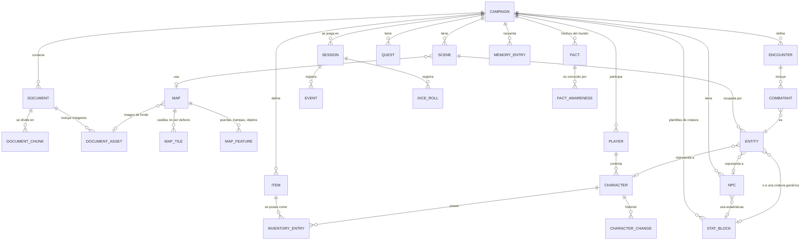

# 3. Modelo de datos

> Cubre el punto 8 (modelo de datos y relaciones) y la sección 15 del prompt maestro.

## 3.1 Idea central: verdad del mundo ≠ conocimiento de los jugadores

El modelo separa tres cosas:

1. **Estado real** del mundo: dónde está cada criatura, qué trampas existen, qué sabe cada NPC. Tablas como `entity`, `trap`, `map_tile`.
2. **Conocimiento**: qué hechos existen (`fact`) y quién conoce cada uno (`fact_awareness`): el grupo, un personaje concreto o un NPC.
3. **Historia**: el registro inmutable de lo que ha pasado (`event`), del que se derivan los resúmenes y la memoria.

Un enemigo emboscado existe en `entity` con posición, pero no aparece en la proyección de los jugadores porque ningún personaje tiene un `perception_state` que lo marque como visible y no hay un `fact_awareness` sobre él.

## 3.2 Diagrama entidad-relación

## 3.3 Tablas

Convenciones:

- Claves primarias `id` como texto UUIDv7 (ordenables por tiempo y seguras para una futura sincronización multidispositivo).
- `created_at` y `updated_at` en UTC en todas las tablas.
- Columnas JSON validadas con modelos Pydantic antes de escribir (SQLite guarda JSON como texto; la validación es responsabilidad de la aplicación).
- `ON DELETE CASCADE` desde `campaign` hacia todo lo que le pertenece; `RESTRICT` donde borrar rompería la historia (por ejemplo, no se puede borrar un `character` con eventos: se archiva).
- `PRAGMA foreign_keys = ON` en cada conexión.

### Campaña y documentos

| Tabla | Columnas principales | Restricciones |
|---|---|---|
| `campaign` | `id`, `name`, `description`, `game_system` (`dnd5e_2014`), `rules_config` JSON, `dice_mode` (`digital`/`manual`/`ask`), `dm_pin_hash`, `status` | `name` no vacío; `game_system` en lista permitida |
| `document` | `id`, `campaign_id` FK, `title`, `file_path`, `sha256`, `page_count`, `kind` (`adventure`/`supplement`/`rules`/`notes`), `processing_status`, `processing_log` JSON | `UNIQUE(campaign_id, sha256)` evita importar dos veces el mismo PDF |
| `document_chunk` | `id`, `document_id` FK, `page_start`, `page_end`, `section_path` (p. ej. "Cap. 2 › Área 7"), `kind` (`narrative`/`read_aloud`/`stat_block`/`table`/`sidebar`), `text`, `knowledge_level` (`public`/`conditional`/`dm`), `classification_source` (`ai`/`manual`), `scene_id` FK nullable, `embedding` (tabla virtual vec asociada) | `knowledge_level` obligatorio; por defecto `dm` hasta que se clasifique (**cerrado por defecto**) |
| `document_asset` | `id`, `document_id` FK, `page`, `file_path`, `width`, `height`, `kind` (`map`/`illustration`/`handout`/`unknown`), `knowledge_level` | Mismo criterio: `dm` por defecto |

Además, `document_chunk_fts` (FTS5) y `document_chunk_vec` (sqlite-vec) indexan `document_chunk.text` y se mantienen con disparadores.

### Escenas y mapas

| Tabla | Columnas principales | Restricciones |
|---|---|---|
| `scene` | `id`, `campaign_id` FK, `name`, `summary_public`, `summary_dm`, `source_chunk_ids` JSON, `map_id` FK nullable, `status` (`unvisited`/`active`/`visited`), `order_hint` | — |
| `map` | `id`, `campaign_id` FK, `name`, `origin` (`pdf`/`generated`/`manual`), `background_asset_id` FK nullable, `width_cells`, `height_cells`, `cell_size_ft` (5 por defecto), `grid_offset_px` JSON, `cell_size_px`, `default_terrain`, `lighting_default` (`bright`/`dim`/`dark`) | `width_cells`, `height_cells` entre 1 y 200 |
| `map_tile` | `map_id` FK, `x`, `y`, `terrain` (`floor`/`wall`/`difficult`/`water`/`pit`/`void`), `blocks_movement`, `blocks_sight`, `cover` (`none`/`half`/`three_quarters`/`total`), `light` nullable | **PK compuesta** `(map_id, x, y)`; `0 ≤ x < width`, `0 ≤ y < height` (validado en aplicación). Solo se guardan las casillas que difieren del terreno por defecto |
| `map_feature` | `id`, `map_id` FK, `kind` (`door`/`secret_door`/`trap`/`chest`/`lever`/`stairs`/`light_source`/`zone`), `x`, `y`, `shape` JSON (para zonas), `state` JSON (abierta, cerrada, cerrojo, armada), `knowledge_level`, `fact_id` FK nullable, `interactions` JSON, `dm_notes` | Una puerta secreta tiene `knowledge_level='conditional'` y un `fact_id` que la vincula a su descubrimiento |

### Participantes, personajes y criaturas

| Tabla | Columnas principales | Restricciones |
|---|---|---|
| `player` | `id`, `campaign_id` FK, `display_name`, `color`, `turn_order` | `UNIQUE(campaign_id, display_name)` |
| `character` | `id`, `campaign_id` FK, `player_id` FK nullable, `name`, `race`, `class_levels` JSON (multiclase), `background`, `alignment`, `abilities` JSON (FUE…CAR), `proficiencies` JSON, `hp_max`, `hp_current`, `hp_temp`, `ac_formula` JSON, `speed` JSON, `senses` JSON, `spell_slots` JSON, `spells` JSON, `features` JSON, `xp`, `conditions` JSON, `death_saves` JSON, `status` (`active`/`dead`/`retired`), `version` | `0 ≤ hp_current ≤ hp_max`; `hp_temp ≥ 0`; `version` para control de concurrencia optimista |
| `character_change` | `id`, `character_id` FK, `event_id` FK, `field`, `before` JSON, `after` JSON, `reason` | Solo inserción |
| `stat_block` | `id`, `campaign_id` FK nullable (null = SRD global), `name`, `size`, `type`, `ac`, `hp_formula`, `speed` JSON, `abilities` JSON, `saves` JSON, `skills` JSON, `resistances`/`immunities`/`vulnerabilities` JSON, `condition_immunities` JSON, `senses` JSON, `languages`, `cr`, `actions` JSON, `traits` JSON, `source` (`srd51`/`document:<id>`/`manual`) | `cr` en valores válidos de 5e |
| `npc` | `id`, `campaign_id` FK, `name`, `public_description`, `personality` JSON (rasgos, ideales, vínculos, defectos), `motivations`, `goals`, `fears`, `secrets`, `voice_style`, `attitude_default` (`hostile`/`indifferent`/`friendly`), `stat_block_id` FK nullable, `location_scene_id` FK nullable, `status` (`alive`/`dead`/`missing`) | `secrets`, `motivations` y `goals` solo salen por la API del DM |
| `npc_attitude` | `npc_id` FK, `character_id` FK, `attitude`, `notes` | PK `(npc_id, character_id)` |
| `entity` | `id`, `scene_id` FK, `map_id` FK nullable, `kind` (`character`/`npc`/`creature`/`object`), `character_id`/`npc_id`/`stat_block_id` FK nullable, `name_public` (p. ej. "figura encapuchada"), `x`, `y`, `hp_current`, `hp_max`, `conditions` JSON, `hidden` bool, `stealth_total` nullable, `disposition` (`ally`/`neutral`/`hostile`) | `CHECK` exactamente una de `character_id`, `npc_id`, `stat_block_id` cuando `kind ≠ object`; `UNIQUE(map_id, x, y)` **no** se impone (criaturas pequeñas pueden compartir), se valida en el motor |
| `perception_state` | `observer_character_id` FK, `entity_id` FK, `state` (`visible`/`detected`/`hidden`/`out_of_sight`), `last_known_x`, `last_known_y` | PK `(observer_character_id, entity_id)` |
| `fog_cell` | `map_id` FK, `x`, `y`, `explored_by` (`party` o id de personaje) | PK `(map_id, x, y, explored_by)` |

### Encuentros y combate

| Tabla | Columnas principales | Restricciones |
|---|---|---|
| `encounter` | `id`, `campaign_id` FK, `scene_id` FK, `name`, `description_dm`, `status` (`planned`/`active`/`resolved`), `round`, `turn_index`, `source_chunk_ids` JSON | Solo un `active` por campaña (índice parcial `UNIQUE(campaign_id) WHERE status='active'`) |
| `combatant` | `id`, `encounter_id` FK, `entity_id` FK, `initiative`, `initiative_tiebreak`, `has_action`, `has_bonus_action`, `has_reaction`, `movement_left_ft`, `concentration_on` nullable, `is_surprised` | `UNIQUE(encounter_id, entity_id)` |

### Sesiones, eventos y tiradas

| Tabla | Columnas principales | Restricciones |
|---|---|---|
| `session` | `id`, `campaign_id` FK, `number`, `started_at`, `ended_at`, `active_player_id` FK nullable, `state` (`exploring`/`awaiting_roll`/`combat`/`paused`/`closed`), `summary` JSON | `UNIQUE(campaign_id, number)` |
| `event` | `id`, `campaign_id` FK, `session_id` FK, `seq`, `type`, `actor_kind` (`player`/`ai`/`dm`/`system`), `actor_id`, `payload` JSON, `visibility` (`public`/`dm`/`character:<id>`), `caused_by_event_id` FK nullable | `UNIQUE(campaign_id, seq)`; **solo inserción** (disparador que rechaza `UPDATE`/`DELETE`). Las correcciones son nuevos eventos de tipo `correction` |
| `dice_roll` | `id`, `session_id` FK, `event_id` FK, `character_id` FK nullable, `entity_id` FK nullable, `purpose` (`ability`/`skill`/`save`/`attack`/`damage`/`initiative`/`death_save`/`custom`), `expression`, `mode` (`digital`/`manual`), `advantage` (`none`/`advantage`/`disadvantage`), `dice` JSON (todos los dados y cuáles se conservaron), `modifiers` JSON (desglose), `total`, `dc` nullable, `dc_visible` bool, `outcome` (`pending`/`success`/`failure`/`critical`/`fumble`/`void`), `requested_by` (`ai`/`dm`/`player`) | Cada valor de dado dentro de `1..caras`; `pending` hasta que llega el resultado; un resultado manual no se modifica (una anulación crea otra fila con `outcome='void'` en la original) |

### Misiones, objetos, conocimiento y memoria

| Tabla | Columnas principales | Restricciones |
|---|---|---|
| `quest` | `id`, `campaign_id` FK, `title_public`, `description_public`, `description_dm`, `status` (`unknown`/`offered`/`active`/`completed`/`failed`), `giver_npc_id` FK nullable, `parent_quest_id` FK nullable | — |
| `item` | `id`, `campaign_id` FK nullable (null = SRD), `name`, `name_unidentified`, `kind`, `weight`, `cost_cp`, `properties` JSON, `magic` JSON, `requires_attunement`, `description_public`, `description_dm` | — |
| `inventory_entry` | `id`, `item_id` FK, `owner_kind` (`character`/`entity`/`map_feature`/`scene`), `owner_id`, `quantity`, `equipped`, `attuned`, `identified` | `quantity > 0`; máximo 3 objetos sintonizados por personaje (validado en servicio) |
| `fact` | `id`, `campaign_id` FK, `subject_kind`, `subject_id`, `statement`, `knowledge_level` (`public`/`conditional`/`dm`), `discovery_conditions` JSON (p. ej. `{skill: "investigation", dc: 15, tiers: [...]}`), `source_chunk_id` FK nullable, `status` (`true`/`false_rumor`/`hypothesis`) | Una afirmación falsa que circula en el mundo se guarda como `false_rumor`, para no confundirla con la verdad |
| `fact_awareness` | `fact_id` FK, `knower_kind` (`party`/`character`/`npc`), `knower_id`, `learned_event_id` FK, `confidence` (`certain`/`suspected`) | PK `(fact_id, knower_kind, knower_id)` |
| `memory_entry` | `id`, `campaign_id` FK, `scope` (`campaign`/`character`/`npc`/`quest`/`location`/`session`), `scope_id`, `content`, `importance` 1–5, `source_event_ids` JSON, `visibility` (`public`/`dm`), `edited_by_dm` bool, `superseded_by` FK nullable | Las correcciones crean una entrada nueva y marcan la antigua como reemplazada |

## 3.4 Reglas de integridad que viven en el código

SQLite no puede expresar todo. Estas reglas las impone la capa de servicios, con pruebas:

- Las columnas de PG, posiciones, espacios de conjuro y condiciones **solo** se escriben desde los servicios del motor, nunca desde rutas de la API ni desde la IA directamente.
- Cada escritura mecánica ocurre en la misma transacción que su `event` y su `character_change`.
- `character.version` se incrementa en cada escritura; una escritura con versión obsoleta se rechaza (útil cuando la IA y el DM tocan la misma ficha).
- Las consultas para la API de jugadores pasan por el **gestor de conocimiento**, que añade siempre el filtro de visibilidad. Las rutas de jugadores no tienen acceso al repositorio "crudo".

## 3.5 Decisiones de modelado a destacar

- **`MapTile` disperso**: un mapa de 60×40 tiene 2 400 casillas, pero la mayoría son suelo. Guardar solo las distintas al terreno por defecto reduce el tamaño y simplifica la edición. El motor de mapas carga el mapa completo en memoria como una matriz.
- **`Enemy` no es una tabla aparte**: el prompt maestro lista `NPC` y `Enemy`. En la práctica un NPC puede volverse hostil y un enemigo puede rendirse y negociar. Por eso se separa la **identidad** (`npc`: personalidad, secretos), las **estadísticas** (`stat_block`) y la **presencia en una escena** (`entity`, con `disposition`). Un "enemigo" es una `entity` con `disposition='hostile'`. Se puede crear una vista `enemy` si resulta cómodo.
- **`Inventory` como entradas**: `item` es la definición y `inventory_entry` la posesión, para que el mismo objeto pueda estar en un cofre, en el suelo o en una mochila.
- **Eventos inmutables**: permiten reconstruir la partida, auditar intervenciones del DM y deshacer con eventos compensatorios.
