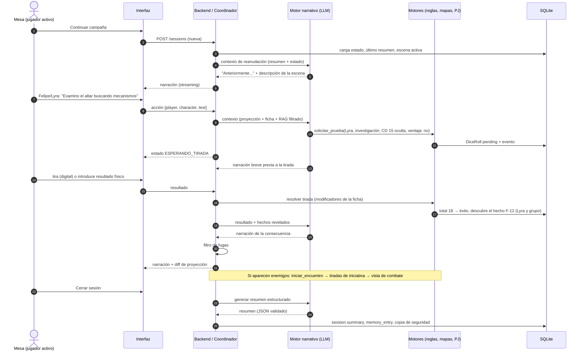
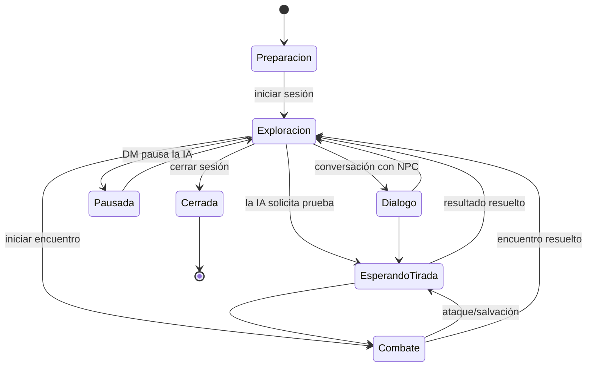

# 4. Interfaz y flujo de una sesión

> Cubre los puntos 9 (diseño de la interfaz) y 10 (flujo completo de una sesión).

## 4.1 Principios de diseño

- **Pantalla compartida primero.** Pensada para un monitor grande o una TV a 1–2 m: texto base de 18 px, contraste alto, objetivos de clic grandes. También usable en portátil.
- **Mesa, no chat.** La narración se presenta como páginas de un libro de campaña (bloques con tipografía serif, iniciales ornamentadas en el texto leído en voz alta), no como burbujas de mensajes.
- **Fantasía oscura sobria.** Paleta: fondo tinta (#15120f), pergamino (#e9dfc7) para superficies de lectura, oro viejo (#b8913a) para acentos, rojo sangre (#8b1e1e) para daño y peligro, verde musgo (#4f6b3a) para curación. Tipografías: una serif con carácter para títulos (p. ej. *Cinzel* o *IM Fell*), serif legible para narración (*EB Garamond*), sans para datos (*Inter*). Todas con licencia libre (OFL) y servidas localmente para funcionar sin Internet.
- **La información secreta no "se oculta": no llega.** La vista de jugadores solo pinta lo que el backend le envía.

## 4.2 Pantallas

### Inicio (biblioteca de campañas)

Tarjetas de campañas con portada (primera imagen del PDF o una elegida), última sesión, número de sesiones. Acciones: crear campaña, continuar, importar PDF, gestionar copias de seguridad.

### Preparación de campaña

Asistente en pasos: (1) datos básicos y modo de dados; (2) subir PDF y ver el progreso del procesamiento; (3) revisar escenas, NPC y mapas detectados; (4) revisar la clasificación de secretos (requiere modo DM); (5) registrar participantes y personajes; (6) definir el PIN del DM.

### Mesa (vista principal durante el juego)

```text
┌──────────────────────────────────────────────────────────────────────────┐
│  ⚔ La Cripta del Rey Ceniza · Sesión 4 · Exploración        [🗺] [🎲] [🔒DM]│
├───────────────┬──────────────────────────────────────┬───────────────────┤
│ PERSONAJES    │  NARRACIÓN                           │ ESCENA            │
│               │                                      │ Sala del osario   │
│ ▶ Eduardo     │  ❝ El pasillo desemboca en una       │ Luz: tenue        │
│   Thorin  ♥32 │  cámara abovedada. Huesos apilados   │                   │
│   CA 18       │  forman nichos a lo largo de los     │ [miniatura mapa]  │
│               │  muros... ❞                          │                   │
│   Felipe      │                                      │ DESCUBIERTO       │
│   Lyra    ♥21 │  ─ Lyra examina el altar ─           │ • Inscripción     │
│               │  🎲 Investigación: 14 + 4 = 18       │   en élfico       │
│   Juan        │                                      │ • Llave de hueso  │
│   Brom    ♥40 │  Bajo el polvo distingues...         │                   │
│               │                                      │ MISIONES          │
│ [+ jugador]   │                                      │ • Encontrar al    │
│               │                                      │   heredero        │
├───────────────┴──────────────────────────────────────┴───────────────────┤
│ Actúa: [Eduardo · Thorin ▾]  ¿Qué hace Thorin? ______________  [Enviar]   │
│ Eduardo → Felipe → Juan → (siguiente)                [Tirada pendiente: —]│
└──────────────────────────────────────────────────────────────────────────┘
```

- **Selector de jugador activo** siempre visible junto al campo de acción, con atajo de teclado (Tab / números) y la secuencia "Eduardo → Felipe → Juan → siguiente".
- **Tirada pendiente**: cuando el DM pide una tirada, el campo de acción se bloquea y aparece un panel grande: tipo de prueba, personaje, ventaja/desventaja, botón "Tirar" (digital) o casilla para introducir el resultado del dado físico. La CD no se muestra salvo que sea pública.
- **Ficha**: al pulsar un personaje se abre un panel lateral con la ficha completa (características, habilidades, salvaciones, ataques, conjuros, inventario, condiciones, historial de cambios).

### Exploración

La narración ocupa el centro; el mapa se abre como panel ampliable a la derecha o a pantalla completa. Tokens de personajes visibles; niebla de guerra sobre lo no explorado (fase 6).

### Combate

Se activa automáticamente al iniciarse un encuentro. El mapa táctico ocupa ~65 % de la pantalla:

- Barra superior: orden de iniciativa con retratos, ronda y combatiente activo resaltado.
- Panel del combatiente activo: acción / adicional / reacción (encendidas o gastadas), movimiento restante, PG, condiciones, concentración.
- Al seleccionar un token propio: casillas alcanzables sombreadas; al pasar sobre un objetivo: distancia y si está en alcance.
- Enemigos: nombre público, tamaño y estado aparente ("ileso", "herido", "malherido", "a punto de caer"), nunca PG exactos salvo configuración.
- Registro de combate plegable y narración accesible en una columna estrecha.

### Modo DM (privado)

- Se activa con el botón 🔒 y un PIN. **Antes** de mostrar nada, la pantalla pasa a un fondo neutro con el aviso "Modo DM: que los jugadores no miren", y se pide el PIN.
- Pestañas: Escena (texto completo del PDF de la escena actual con referencias de página), Secretos y hechos, Mapa completo (sin niebla, con trampas y enemigos ocultos), Criaturas y NPC, CD y tiradas, Memoria y eventos (editable), Configuración de la IA (pausar, cambiar proveedor).
- Al salir: se borra el estado DM del cliente (store separado), se cierra el WebSocket `/ws/dm`, se recarga la proyección de jugadores y se muestra un fundido a negro de un segundo para evitar que quede algo en pantalla. El token DM caduca a los 15 minutos de inactividad.

## 4.3 Flujo completo de una sesión



### Estados de la partida



El coordinador rechaza acciones que no correspondan al estado: con una tirada pendiente no se aceptan acciones nuevas (salvo cancelar), y en combate solo actúa el combatiente activo o quien tenga una reacción disponible.
